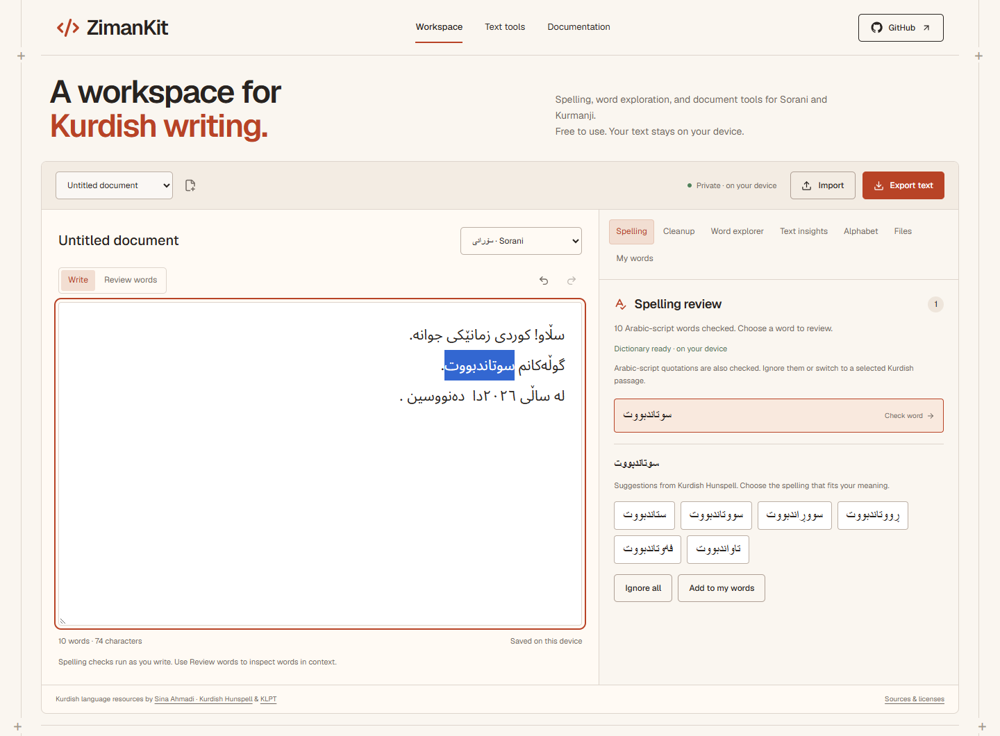

# ZimanKit

A writing workspace for Kurdish, with tools for Sorani and Kurmanji spelling, text cleanup, and document editing.

[Open ZimanKit](https://zimankit.sorinlab.com/) · [User guide](https://zimankit.sorinlab.com/docs/) · [Sources and licenses](https://zimankit.sorinlab.com/credits/)



## What you can do

- Check Sorani and Kurmanji spelling, review suggestions, and save words to a personal dictionary.
- Review letter, spacing, punctuation, and number changes before applying them.
- Look up possible dictionary forms, roots, and word types.
- Count vocabulary, filter common words, and export word lists as CSV.
- Make an editable Arabic/Latin alphabet conversion draft.
- Import TXT, Markdown, or Word documents. Export text or a new Word document, or clean several files and download a ZIP with reports.

The workspace processes documents on your device. Dictionaries download from the site; drafts and personal words stay in this browser. There is no account or sync, so export anything you want to keep before clearing browser data.

## Run locally

Use Node.js 24 and npm.

```sh
git clone https://github.com/zanaamed/zimankit.git
cd zimankit
npm ci
npm run dev
```

Open [localhost:3000](http://localhost:3000). The setup script checks the bundled Kurdish resources and prepares the Hunspell browser engine.

For tests, type checking, and a production build:

```sh
npm run check
```

To preview the production site and API locally:

```sh
npm run build
npm run preview -- --local
```

The frontend uses Next.js and React. Spelling runs in a browser worker. A Cloudflare Worker serves the built site and a separate text-processing API. See [development notes](docs/DEVELOPMENT.md) for deployment and API details.

## Library and API

The [core library](packages/core/README.md) provides Unicode normalization, cleanup, script detection, text counts, and experimental transliteration. It can be built and installed from this repository; it is not published to npm yet.

The API exposes that core text processing at `/api/v1/process`. It does not include the workspace's spelling checks or document tools. Using the API sends your input to the server; using the browser workspace does not.

## Limits

An unrecognized word can still be correct. Names, regional vocabulary, and mixed-language passages may need manual review. Alphabet conversion is experimental and does not recover unwritten vowels. There is no translation or full grammar checking.

The workspace accepts up to 100,000 characters per document and 20 files per batch. Word import keeps text and paragraphs, but not the original formatting, images, or tables. The core library accepts 20,000 UTF-16 code units per input; the public API accepts 2,000.

## Kurdish resources and credits

Spelling and word analysis use [Kurdish Hunspell](https://github.com/sinaahmadi/KurdishHunspell). Cleanup and common-word filtering use selected data from [KLPT](https://github.com/sinaahmadi/klpt). Both are by **Sina Ahmadi**. Their bundled files are unchanged, with source revisions and checksums recorded in [resources.json](public/licenses/resources.json).

ZimanKit uses KLPT's preparation-rule data and common-word lists, rather than bundling the full Python toolkit. The alphabet converter is a separate implementation in ZimanKit.

The browser engine uses [hunspell-wasm](https://github.com/rotemdan/hunspell-wasm) by Rotem Dan and the Hunspell contributors. Its corresponding source is included in [this archive](public/licenses/hunspell-wasm-0.3.0-source.zip).

## License and contributions

ZimanKit's original code uses the [MIT license](LICENSE). Kurdish Hunspell and KLPT resources retain **CC BY-SA 4.0**; hunspell-wasm retains its upstream license under the **MPL 1.1 option**. Fonts and other dependencies keep their own licenses. See [third-party notices](public/licenses/THIRD_PARTY_NOTICES.txt) for details.

For bugs or Kurdish spelling examples, [open an issue](https://github.com/zanaamed/zimankit/issues). Include a short example, the selected variety, and the result you expected. [Contribution notes](CONTRIBUTING.md) cover code changes and resource updates.
